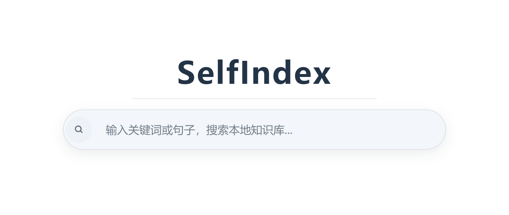

# SelfIndex

SelfIndex 是一个 alpha 阶段的个人记忆系统，专注于保存原始资料、构建可搜索的记忆单元，并为变化的数据保持修订历史。

它目前还不是一个通用 AI Agent 产品。当前的目标是让记忆管道稳定可靠：

- 保存原始资料
- 保留当前状态和修订历史
- 派生可搜索的记忆单元
- 支持可追溯的本地向量检索
- 支持浏览器捕获的 AI 对话和文件导入

## 当前状态

SelfIndex 适合本地个人使用和持续实验。

已支持的功能：

- ChatGPT、Grok、DeepSeek 导出的json文件导入
- ChatGPT 浏览器捕获与半自动同步
- Grok 浏览器捕获与懒加载快照合并
- Markdown 目录同步
- 修订感知的原始文档存储
- 可追溯到源文档的本地向量检索
- 受保护的召回域和解锁式查询
- SQLite / SQLCipher 存储

目前仍是 alpha 软件：

- 浏览器捕获依赖页面结构，网站变更可能导致功能失效
- 多平台支持仍在早期阶段
- 对话回放界面尚未完成
- Windows 托盘运行时与 macOS 桌面客户端目前是两套入口
- macOS 桌面客户端与后台服务仍处于开发版打包阶段

## 推荐启动方式

在 macOS 上，先同步依赖并生成可点击的开发版 App：

```bash
uv sync
.venv/bin/python -m scripts.build_macos_dev_app
```

从 Finder 打开 `dist-dev/SelfIndex.app`。它会在需要时创建或唤起用户级 LaunchAgent；也可手动管理：

```bash
.venv/bin/python -m scripts.macos_launch_agent install
.venv/bin/python -m scripts.macos_launch_agent status
.venv/bin/python -m scripts.macos_launch_agent restart
.venv/bin/python -m scripts.macos_launch_agent uninstall
```

开发版 `.app` 仍依赖本项目目录和 `.venv`，暂不能独立拷贝到其他 Mac。关闭窗口后客户端保留在 Dock，菜单中可明确退出；后台服务独立运行。窗口大小、位置、最大化状态和结果/详情分栏比例会保存在 macOS 用户偏好中；搜索词和正文不会写入界面偏好。单次调试可运行 `.venv/bin/python -m desktop_mac.main`。现有 `selfindex_service.sh` 是备用入口，不要与 LaunchAgent 同时管理；同一资料库的第二个写入进程会被拒绝。导入、同步和索引修复须在停服维护窗口执行；只读预览不需写入租约。

其他本机 App 可调用 `GET http://127.0.0.1:5050/api/v1/search?query=...&limit=10` 和 `/api/v1/memory/<id>`。编辑与浏览器导入需要本机写令牌，默认位于 `data/api-write-token`，文件权限为当前用户读写。

`GET /api/v1/health` 表示服务可响应；`GET /api/v1/status` 才显示索引能力、资料库身份和待处理队列。本机读接口信任同一登录用户，不提供进程级权限隔离；解锁前缀只是搜索过滤。SQLCipher 不覆盖 Chroma、原始导出、Markdown 来源与备份。不要开放非本机监听地址。

接口细节见 [本机 API v1](docs/local-api_ZH.md)。

在 Windows 上，使用 PowerShell 脚本。默认会将桌面运行时、系统托盘图标和 Web 服务一起启动：

```powershell
.\scripts\selfindex_service.ps1 start
```

Windows 常用命令：

```powershell
.\scripts\selfindex_service.ps1 status
.\scripts\selfindex_service.ps1 restart
.\scripts\selfindex_service.ps1 stop
```

如果只需要 Web 服务而不需要托盘运行时：

```powershell
.\scripts\selfindex_service.ps1 start -NoTray
```

默认地址：

- 旧版 Web UI（过渡期保留）: `http://127.0.0.1:5050/`
- 浏览器采集: `http://127.0.0.1:5050/api/ingest/browser-conversation`

## 主要工作流程

### 导入导出的对话文件

```bash
python -m scripts.import_exports --file data/raw_exports/your_export.json
```

导入时跳过嵌入：

```bash
python -m scripts.import_exports --file data/raw_exports/your_export.json --skip-embedding
```

后续再构建嵌入：

```bash
python -m scripts.build_embeddings
python -m scripts.build_embeddings --batch-size 16 --max-units 200
```

索引删除任务会随归档变更保存在 SQL 中；下次服务启动或执行补建时会尝试重放。检查 SQL/Chroma 差异与待删除任务可运行 `python -m scripts.repair_chroma_consistency`。该默认审计检查 ID、正文、元数据和模型版本，SQL 使用只读连接；Chroma 仅调用读取接口。旧索引若没有模型标识，会阻止检索和新增向量，须在停服、备份、对账无漂移后显式认领模型。具体步骤见[索引一致性与模型切换](docs/index-integrity_ZH.md)。现存旧孤儿不会由新任务表自动识别。

### 同步 Markdown 目录

旧 Windows OneDrive 来源的 126 篇 Markdown 归档已按要求**软停用**：库内原文和修订保留，Mac 上的文件不受影响，搜索暂不包含它们。新旧 Obsidian 目录并非一一对应；不要直接对 Mac 目录执行真实同步。范围、备份和恢复办法见[旧 Markdown 来源状态](docs/markdown-source-status_ZH.md)。

```bash
python -m scripts.sync_markdown_directory --dir path/to/notes --ignore-file path/to/notes/.selfindexignore --skip-embedding
```

如果目录不存在、扫描失败，或目录变空但库中仍有该来源的文档，同步会停止以避免整批误失活。确认确实要清空该来源时，显式增加 `--allow-empty-source`；单个文件删除仍按原有方式同步。

执行前可加 `--dry-run` 预览新增、更新、失活数量；旧 Windows 来源路径尚未映射到 Mac，勿直接把新目录当作同一来源执行真实同步。由 App 编辑的 Markdown 正文会写回源文件，源文件待写期间同步会拒绝运行。

### 停服备份

对当前统一 `DATA_DIR` 资料库，先停 LaunchAgent、确认无其他写入进程，再执行：

```bash
.venv/bin/python -m scripts.backup_profile \
  --destination "$HOME/Library/Application Support/SelfIndex/backups/自定唯一名称" \
  --confirm-service-stopped
```

命令复制配置与完整资料目录、逐文件验证 SHA-256、设为当前用户私有权限且拒绝覆盖旧备份。备份后仍需在隔离位置演练 SQLCipher 与 Chroma 恢复；同盘备份不能防磁盘故障，长期归档还需单独的加密异盘副本。不要在服务运行时复制 Chroma 并把它当作一致快照。

`.selfindexignore` 示例：

```text
archive/
templates/*
draft.md
```

### 管理受保护术语

```bash
python -m scripts.manage_protected_terms list
python -m scripts.manage_protected_terms add "敏感文本" --domain sensitive
python -m scripts.manage_protected_terms add "真实姓名" --domain identity
```

回填召回域：

```bash
python -m scripts.backfill_recall_domains --dry-run
python -m scripts.backfill_recall_domains
```

### 浏览器捕获

浏览器扩展位于：

`browser_capture/ai_capture_extension`

当前支持的浏览器：

- ChatGPT：新增消息的增量同步
- Grok：懒加载历史的快照合并

该扩展目前面向本地采集到运行中的 SelfIndex 实例。

## 检索模型

SelfIndex 使用召回域来控制敏感内容的检索。

- 默认查询只检索 `default` 域
- 显式前缀可解锁受保护的域

当前前缀在 `.env` 中配置：

```env
UNLOCK_PREFIX_IDENTITY=:
UNLOCK_PREFIX_SENSITIVE=!
```

## 文档

从[文档索引](docs/README_ZH.md)进入；历史说明集中在 `docs/archive/`，2026-09-26 审计证据保持原位。

## 运行测试

```bash
python -m unittest discover -s tests -v
```

## 项目定位

SelfIndex 最好的描述是：

- 本地优先的个人记忆原型
- 修订感知的归档加检索系统
- 活跃的研究和实现仓库

它目前还不应作为成熟的终端用户产品呈现。
